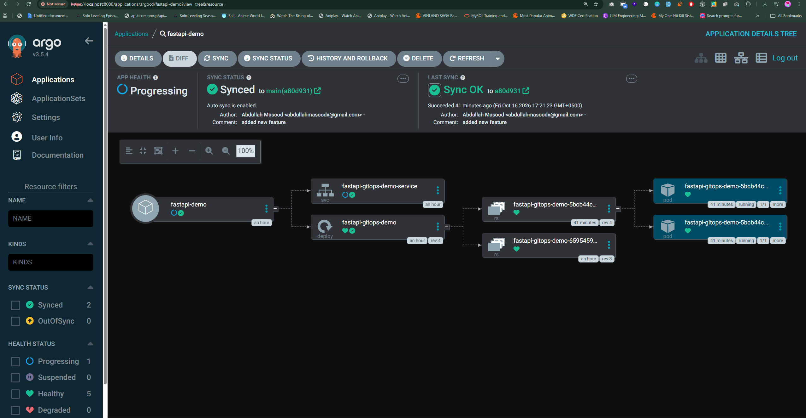

# FastAPI + Docker + Helm + Kubernetes + Argo CD

A learning project demonstrating a containerized FastAPI application deployed to Kubernetes using Helm templates and managed through Argo CD GitOps.

> **Documentation status:** This guide was prepared from deployment commands, chart configuration, and Argo CD settings shared in the conversation. The public repository contents could not be fetched for independent verification. Confirm filenames, Docker image, endpoints, and exact chart values against the repository before publishing this as its README.

## Architecture

```text
FastAPI source + Dockerfile
          |
          v
  Docker image (Docker Hub)
          |
          v
GitHub repository (myapp-chart/)
          |
          v
Argo CD Application (tracks main)
          |
          v
Helm renders Kubernetes manifests
          |
          v
Kubernetes Deployment --> Pods (FastAPI :5001)
          ^
          |
Kubernetes Service (:80 -> :5001)
          ^
          |
  kubectl port-forward (:5001 -> :80)
```

Argo CD uses Helm as a template renderer: it does **not** run `helm install` or create a normal Helm CLI release when managing the chart.

## Argo CD deployment screenshot



*Argo CD dashboard showing `fastapi-demo` synced to the `main` branch (commit `a80d931`), successful last sync, and two running FastAPI pods. At capture time, overall application health was **Progressing**, so this screenshot confirms successful synchronization and running pods, not a fully Healthy application.*

To reproduce this view, open the Argo CD UI and select **Applications → fastapi-demo → Tree**. Verify both the sync status and health status, and check the Deployment details if health remains **Progressing**.


## Prerequisites

- Git, Docker and Docker Hub access (for rebuilding/pushing)
- `kubectl`, `helm`, and `minikube`
- Kubernetes cluster with Argo CD installed in namespace `argocd`
- Public image `abdullahmasoodx/fastapi-helm:v1` **if that tag exists and is public**

Check your tools:

```powershell
kubectl version --client
helm version
minikube status
kubectl config current-context
kubectl get nodes
kubectl get pods -n argocd
```

## 1. Clone repository

```powershell
git clone https://github.com/abdullahmasoodx/fastapi-argo-demo.git
cd fastapi-argo-demo
```

The chart path discussed for the Argo CD Application is `myapp-chart` (verify `myapp-chart/Chart.yaml` exists).

## 2. Inspect before deploying

```powershell
helm lint ./myapp-chart
helm template fastapi-demo ./myapp-chart
helm show values ./myapp-chart
```

Check that the rendered Deployment image exists and the FastAPI container listens on the same port as the Service `targetPort`.

Example Helm values (illustrative; verify against actual chart):

```yaml
replicaCount: 2
image:
  repository: abdullahmasoodx/fastapi-helm
  tag: "v1"
  pullPolicy: IfNotPresent
service:
  type: NodePort
  port: 80
  targetPort: 5001
```

The previously observed Service allocated NodePort `31317`, but this may change after Service recreation; do not assume it is fixed.

## 3. Option A: test Helm without Argo CD

Use this option on a fresh cluster or a different namespace to avoid resource-ownership conflicts with Argo CD.

```powershell
kubectl create namespace fastapi-helm-test --dry-run=client -o yaml | kubectl apply -f -
helm upgrade --install fastapi-test ./myapp-chart -n fastapi-helm-test
kubectl get pods,deploy,svc -n fastapi-helm-test
helm list -n fastapi-helm-test
```

If the chart hardcodes `metadata.namespace: default`, fix that first. Chart-created resources should normally use the selected release namespace or omit the resource namespace.

Clean up the standalone Helm test:

```powershell
helm uninstall fastapi-test -n fastapi-helm-test
kubectl delete namespace fastapi-helm-test
```

## 4. Option B: deploy using Argo CD (recommended GitOps path)

The Application discussed in the project:

```yaml
apiVersion: argoproj.io/v1alpha1
kind: Application
metadata:
  name: fastapi-demo
  namespace: argocd
spec:
  project: default
  source:
    repoURL: https://github.com/abdullahmasoodx/fastapi-argo-demo.git
    targetRevision: main
    path: myapp-chart
    helm:
      valueFiles:
        - values.yaml
  destination:
    server: https://kubernetes.default.svc
    namespace: default
  syncPolicy:
    automated:
      prune: true
      selfHeal: true
    syncOptions:
      - CreateNamespace=true
```

If an Application manifest already exists in the repository, use **that** file instead of creating a duplicate. Find it using:

```powershell
Get-ChildItem -Recurse -File -Include *.yaml,*.yml | Select-String 'kind: Application'
```

Apply the actual Application manifest, for example:

```powershell
kubectl apply -f .\application.yaml
```

(Adjust filename/path to match the repo.)

Check status:

```powershell
kubectl get applications -n argocd
kubectl describe application fastapi-demo -n argocd
kubectl get deployments,pods,services -n default
```

Open Argo CD UI:

```powershell
kubectl port-forward svc/argocd-server -n argocd 8080:443
```

Visit `https://localhost:8080`. Initial username is commonly `admin` (assuming default bootstrap). For a new install, retrieve the initial password locally:

```powershell
$encoded = kubectl -n argocd get secret argocd-initial-admin-secret -o jsonpath="{.data.password}"
[System.Text.Encoding]::UTF8.GetString([System.Convert]::FromBase64String($encoded))
```

If that bootstrap secret was removed after setting an admin password, use the current password instead.

## 5. Test API via port forwarding

The Service name observed in this project was `fastapi-gitops-demo-service`; verify it still exists:

```powershell
kubectl get svc -n default
kubectl get svc fastapi-gitops-demo-service -n default -o yaml
```

The observed Service configuration used `port: 80`, `targetPort: 5001`, `nodePort: 31317`.

```powershell
kubectl port-forward -n default svc/fastapi-gitops-demo-service 5001:80
```

In another PowerShell window:

```powershell
Invoke-WebRequest http://localhost:5001/ -UseBasicParsing
Invoke-WebRequest http://localhost:5001/health -UseBasicParsing
```

The `/health` endpoint was used in the learning example, but its existence must be checked against the actual source. If enabled, Swagger UI is available at `http://localhost:5001/docs`.

Note: A successful port-forward requires an application listening inside the pod; the service being present is not enough.

## 6. Test GitOps reconciliation

Edit a non-disruptive setting in `myapp-chart/values.yaml`, for example changing `replicaCount` from 2 to 3 (only if not overridden elsewhere).

```powershell
git add myapp-chart
git commit -m "test(gitops): change FastAPI replica count"
git push origin main
```

Argo CD periodically checks the repository. With automated sync configured, it should render and apply the new desired state.

```powershell
kubectl get applications fastapi-demo -n argocd
kubectl get deployments,pods -n default
```

Validate the expected replica count in the rendered Deployment and Kubernetes rollout. A Git push alone does **not** build or publish a new Docker image: that requires a separate build/push workflow or CI pipeline.

## 7. Troubleshooting

### `ErrImageNeverPull`

The node cannot find the image and `imagePullPolicy: Never` prohibits registry downloads. For a public Docker Hub image use `IfNotPresent` and commit the change to Git.

### `ErrImagePull` / `ImagePullBackOff`

Check registry/image/tag/credentials:

```powershell
kubectl describe pod <POD_NAME> -n default
kubectl get deployment -n default -o wide
```

### Port-forward `socat ... 127.0.0.1:5001: Connection refused`

The selected pod is not accepting connections on port 5001. Check the actual Uvicorn startup command, logs, and Service endpoints:

```powershell
kubectl get pods -n default
kubectl logs -n default deployment/<DEPLOYMENT_NAME> --tail=100
kubectl get endpointslices -n default -l kubernetes.io/service-name=fastapi-gitops-demo-service
```

Ensure Uvicorn binds to `0.0.0.0` and the `--port` matches `targetPort` (e.g. 5001). Declaring `containerPort: 5001` does not make the app listen on that port.

### Argo CD reports OutOfSync

Check chart path, rendered resources, target branch, application events, and whether Kubernetes resources are already controlled by an unrelated Helm release.

## 8. Cleanup and safety

Argo CD may delete resources automatically if `prune: true` and they disappear from Git. Avoid pointing Argo CD and a standalone Helm CLI release at the same Kubernetes resources.

To remove only the Argo CD Application definition without specifying resource deletion behavior:

```powershell
kubectl delete application fastapi-demo -n argocd
```

Whether workloads are also deleted depends on finalizers and deletion settings. Check those settings first if you want to retain or deliberately delete workloads. Do not assume deleting an Application is non-destructive.

## 9. Recommendations

- Keep `Dockerfile`, Helm charts, manifests, and non-secret source code public for a demo.
- Never commit passwords, `.env` secrets, kubeconfig, registry tokens, or private certificates. Review Git history too.
- Pin Python dependencies and Docker image versions; avoid mutable `latest` tags for deterministic deployments.
- Add `.dockerignore` and `.gitignore`.
- Set resource requests/limits and HTTP readiness/liveness probes.
- Consider running the container as non-root and using a smaller trusted base image.
- Add FastAPI tests and CI (lint/test/build/push). Argo CD syncs Kubernetes declarations; it does not automatically build images.
- Configure GitHub webhook to Argo CD if prompt sync is desirable; polling also works.
- Document cluster requirements, chart values, security assumptions, and tested commands.
- For production, use managed secrets, RBAC, chart validation, separate namespaces, and reviewed pruning policies.

## Public portfolio test checklist

- [ ] `helm lint ./myapp-chart` passes
- [ ] `helm template` shows correct image, replicas, and ports
- [ ] Argo CD shows `Synced` and `Healthy`
- [ ] Pods show `1/1 Running`
- [ ] Port-forward reaches API endpoint
- [ ] `/docs` is accessible if enabled
- [ ] Git change to replica count reconciles
- [ ] No credentials are present in repo or Git history
- [ ] README and screenshots reflect the actual tested repository

---

**Project purpose:** a practical GitOps learning demonstration, not a claim of a fully production-hardened deployment.
